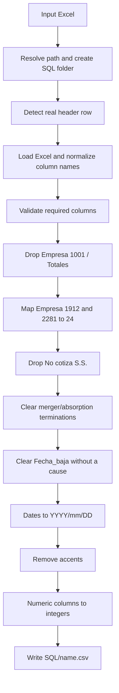

# hr-headcount-excel-to-sql-csv

Cleans and normalizes an HR headcount Excel export and produces a CSV ready to be loaded into SQL.

> Script: `LIMPIEZA_DATOS.py` · Input: `.xlsx` · Output: `SQL/<name>.csv`

## What it does

The script takes an Excel file exported from a payroll/HR system. These files usually have title or summary rows above the real table. It applies a set of business rules and writes a clean CSV with:

- normalized column headers
- invalid rows removed
- unified company codes
- a single date format
- accents removed (`ñ` preserved)
- numeric codes stored as integers

**Personal data notice:** the file contains personal data (employee names, birth dates, terminations). Treat both the Excel and the CSV in line with GDPR/LOPDGDD. Never commit them to the repository.

## Requirements

- Python 3.9 or later
- `pandas`
- `openpyxl`
- `numpy`

```bash
pip install pandas openpyxl numpy
```

## Usage

```bash
python LIMPIEZA_DATOS.py headcount.xlsx
python LIMPIEZA_DATOS.py /full/path/to/headcount.xlsx
```

A relative path is resolved against the folder where the script lives, **not** against the directory you run it from.

Expected output:

```text
OK: archivo generado en /path/SQL/headcount.csv
```

## Output

- A `SQL` folder is created next to the input Excel file if it does not exist.
- The CSV keeps the base name of the Excel file (`headcount.xlsx` → `SQL/headcount.csv`).
- Encoding is `utf-8-sig`, the separator is `,` and no index column is written.
- Excel normally opens this CSV with accents and `ñ` displayed correctly.

## Processing flow



## Header row detection

The script reads the first 10 rows without assuming a header. It uses as the header the first row that, after normalization, contains both `Empresa` and `Nombre_empleado`. If none is found, it raises `ValueError`.

## Column name normalization

Every column name is cleaned: surrounding spaces are trimmed, accents are removed, any non-alphanumeric run becomes `_`, repeated `_` are collapsed and leading/trailing `_` are stripped. `ñ` and `Ñ` are preserved.

| Original | Result |
|---|---|
| `Empleado -  Código` | `Empleado_Codigo` |
| `Cotización seguridad soci` | `Cotizacion_seguridad_soci` |
| `Días percepción I.T.` | `Dias_percepcion_I_T` |

## Required columns

`Empresa`, `Cotizacion_seguridad_soci`, `Causa_de_la_baja`, `Fecha_baja`, `Fecha_alta`, `Fecha_nacimiento`, `Fecha_antiguedad`.

If any is missing, the error lists the missing columns and the columns actually detected.

## Business rules

Rules are applied in this order:

| # | Rule |
|---|---|
| 1 | Drop rows where `Empresa` is `1001` or `Totales` (`Totales` is the report's totals row). Compared as trimmed text. |
| 2 | Replace `Empresa` `1912` and `2281` with `24` (codes of merged companies). |
| 3 | Drop rows where `Cotizacion_seguridad_soci` is `No cotiza S.S.` (employees not paying social security). |
| 4 | If `Causa_de_la_baja` is exactly `Baja por fusión absorción empresa`, clear both `Fecha_baja` and `Causa_de_la_baja`. This is not a real termination. |
| 5 | If `Fecha_baja` holds a valid date but `Causa_de_la_baja` is empty, clear `Fecha_baja`. |
| 6 | Format `Fecha_alta`, `Fecha_nacimiento`, `Fecha_antiguedad` and `Fecha_baja` as `YYYY/mm/DD`. Invalid values become empty. |
| 7 | Strip accents and diaeresis from all text cells, preserving `ñ`/`Ñ`. Nulls and non-text values are left untouched. |
| 8 | Convert to integers without decimals (`4.0` → `4`, empty stays empty): `Empleado_Codigo`, `Dias_alta_en_la_empresa_p`, `Tarifa`, `Codigo_categoria`, `Codigo_contrato`, `Dias_percepcion_I_T`, `Dias_accidente`. |

Examples of rule 7: `TÉCNICOS` → `TECNICOS`, `Categoría` → `Categoria`, `niñez` → `niñez`.

The company codes and the text values used in rules 3 and 4 are hardcoded. If they change at the source, update the script.

## Handled errors

| Situation | Message |
|---|---|
| No argument given | `Uso: python LIMPIEZA_DATOS.py <archivo_excel>` |
| Input file does not exist | `FileNotFoundError` with the path |
| Header row not found | `No se ha encontrado la fila de cabeceras en el Excel` |
| Required columns missing | `ValueError` listing missing and detected columns |

## Known limitations

- **Runs on import.** All processing happens at module level, with no `main()` or `if __name__ == "__main__"` guard. The script cannot be imported or unit-tested without executing it.
- **Hardcoded rules.** Company codes and termination texts live in the code.
- **Header within the first 10 rows.** If there are more preamble rows, detection fails.
- **No discard report.** The script does not say how many rows each rule removed.
- **CSV separator is `,`.** If the target expects `;`, set `sep=";"` in `to_csv`.
- **Messages are in Spanish.** Console output and errors are not translated.

## Repository hygiene

Add this to `.gitignore` so personal data is never committed:

```text
*.xlsx
*.csv
SQL/
```
