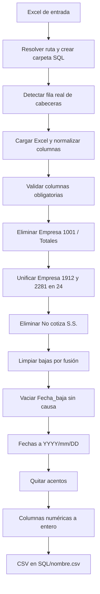

# rrhh-limpieza-plantilla-csv-sql

Limpieza y normalización de un Excel de plantilla de personal (RRHH/nómina) para generar un CSV listo para cargar en SQL.

> Script: `LIMPIEZA_DATOS.py` · Entrada: `.xlsx` · Salida: `SQL/<nombre>.csv`

## Qué hace (resumen)

Toma un Excel exportado del sistema de personal, con filas de título o resumen antes de la tabla real, y aplica reglas de negocio. Genera un CSV limpio con:

- cabeceras normalizadas
- filas no válidas eliminadas
- códigos de empresa unificados
- fechas en formato único
- sin acentos
- códigos numéricos como enteros

Los datos son personales (nombre, fecha de nacimiento, bajas), por lo que el Excel y el CSV deben tratarse conforme a RGPD/LPD. No deben subirse al repositorio.

## Requisitos

- Python 3.9 o superior
- `pandas`
- `openpyxl`
- `numpy`

```bash
pip install pandas openpyxl numpy
```

## Uso

```bash
python LIMPIEZA_DATOS.py plantilla.xlsx
python LIMPIEZA_DATOS.py /ruta/completa/plantilla.xlsx
```

Una ruta relativa se resuelve respecto a la carpeta donde está el script, **no** respecto al directorio desde el que se lanza.

Salida:

```text
OK: archivo generado en /ruta/SQL/plantilla.csv
```

- La carpeta `SQL` se crea junto al Excel de entrada.
- El CSV conserva el nombre base del Excel.
- Codificación `utf-8-sig`, separador `,` y sin índice.
- Excel suele abrir bien ese CSV con tildes y `ñ`.

## Flujo



## Detección de cabecera

Lee las 10 primeras filas sin cabecera. Usa como cabecera la primera fila que, tras normalizar, contenga a la vez `Empresa` y `Nombre_empleado`. Si no la encuentra, lanza `ValueError`.

## Normalización de cabeceras

Quita espacios y acentos, sustituye cualquier carácter no alfanumérico por `_` y colapsa los `_` repetidos. Conserva `ñ` y `Ñ`.

| Original | Resultado |
|---|---|
| `Empleado -  Código` | `Empleado_Codigo` |
| `Cotización seguridad soci` | `Cotizacion_seguridad_soci` |
| `Días percepción I.T.` | `Dias_percepcion_I_T` |

## Columnas obligatorias

`Empresa`, `Cotizacion_seguridad_soci`, `Causa_de_la_baja`, `Fecha_baja`, `Fecha_alta`, `Fecha_nacimiento`, `Fecha_antiguedad`.

Si falta alguna, el error lista las que faltan y las detectadas.

## Reglas de negocio

Se aplican en este orden:

| # | Regla |
|---|---|
| 1 | Elimina las filas con `Empresa` = `1001` o `Totales`. Esta última es la fila de totales del informe. |
| 2 | Sustituye `Empresa` `1912` y `2281` por `24`. Son códigos de empresas fusionadas. |
| 3 | Elimina las filas con `Cotizacion_seguridad_soci` = `No cotiza S.S.`. |
| 4 | Si `Causa_de_la_baja` es exactamente `Baja por fusión absorción empresa`, vacía `Fecha_baja` y `Causa_de_la_baja`. No se considera una baja real. |
| 5 | Si hay `Fecha_baja` válida pero `Causa_de_la_baja` está vacía, vacía `Fecha_baja`. |
| 6 | Convierte `Fecha_alta`, `Fecha_nacimiento`, `Fecha_antiguedad` y `Fecha_baja` a `YYYY/mm/DD`. Si no son fechas válidas, quedan vacías. |
| 7 | Quita tildes y diéresis de todo el texto, conservando `ñ`/`Ñ`. |
| 8 | Convierte a entero sin decimales (`4.0` pasa a `4`, vacío sigue vacío): `Empleado_Codigo`, `Dias_alta_en_la_empresa_p`, `Tarifa`, `Codigo_categoria`, `Codigo_contrato`, `Dias_percepcion_I_T`, `Dias_accidente`. |

Los números de empresa y los textos de las reglas 3 y 4 están escritos directamente en el código. Si cambian en origen, hay que actualizarlos.

## Errores controlados

| Situación | Mensaje |
|---|---|
| Sin argumento | `Uso: python LIMPIEZA_DATOS.py <archivo_excel>` |
| Fichero inexistente | `FileNotFoundError` con la ruta |
| Cabecera no localizada | `No se ha encontrado la fila de cabeceras en el Excel` |
| Faltan columnas | `ValueError` con las faltantes y las detectadas |

## Correcciones necesarias en el script

Se han detectado dos problemas al revisar el código. Hay que corregirlos para que el script y este README coincidan.

### 1. Error de sintaxis al inicio del fichero (el script no arranca)

Las líneas 1 y 2 son:

```text
#Python
Python script
```

La segunda es texto suelto y provoca `SyntaxError`. Hay que borrar ambas líneas, o comentar la segunda con `#`.

### 2. La `ñ` no se conserva: se convierte en `n`

`unicodedata.normalize("NFD", ...)` descompone `ñ` en `n` más una tilde combinada (U+0303). Por eso la comparación `caracter == "ñ"` nunca se cumple. La tilde se elimina por ser categoría `Mn`, y `niñez` acaba como `ninez`. Afecta a los valores y a las cabeceras.

Propuesta para `quitar_acentos`: conservar la tilde U+0303 solo cuando va detrás de `n` o `N`.

```python
def quitar_acentos(valor):
    if not isinstance(valor, str):
        return valor

    resultado = []
    for caracter in unicodedata.normalize("NFD", valor):
        if caracter == "̃" and resultado and resultado[-1] in "nN":
            resultado.append(caracter)
        elif unicodedata.category(caracter) != "Mn":
            resultado.append(caracter)

    return unicodedata.normalize("NFC", "".join(resultado))
```

Con este cambio, `niñez` pasa a `niñez` y `TÉCNICOS` pasa a `TECNICOS`.

## Limitaciones conocidas

- **Ejecución al importar.** Todo el procesado está a nivel de módulo, sin `main()` ni `if __name__ == "__main__"`. No se puede importar ni testear sin que se ejecute.
- **Reglas fijas.** Los códigos de empresa y los textos de baja están escritos en el código.
- **Cabecera en las 10 primeras filas.** Si hay más filas previas, no la detecta.
- **Sin informe de descartes.** No indica cuántas filas se eliminan por cada regla.
- **Separador CSV.** Es `,`. Si el destino espera `;`, hay que indicarlo en `to_csv`.
- **Datos personales.** El Excel y el CSV nunca deben subirse al repositorio. Se recomienda añadir `*.xlsx`, `*.csv` y `SQL/` a `.gitignore`.
